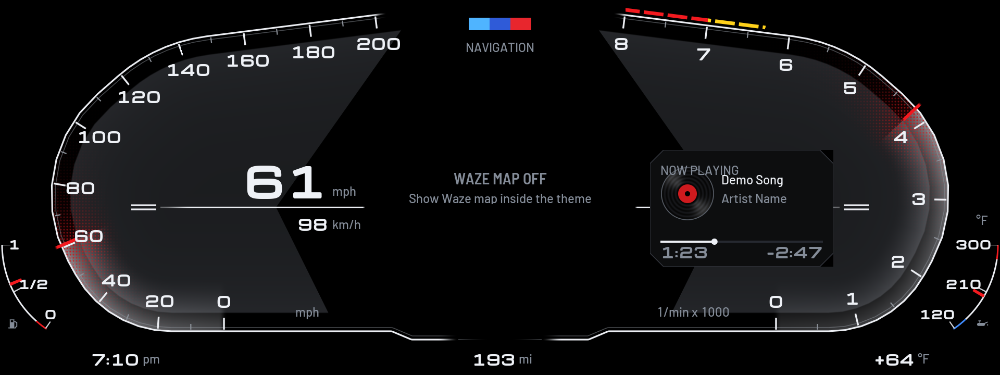
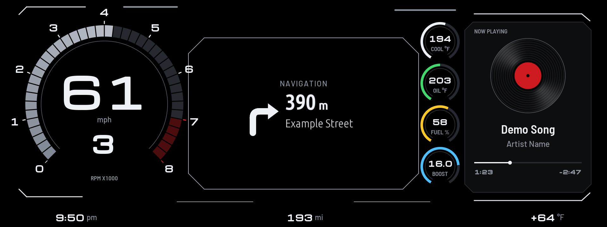
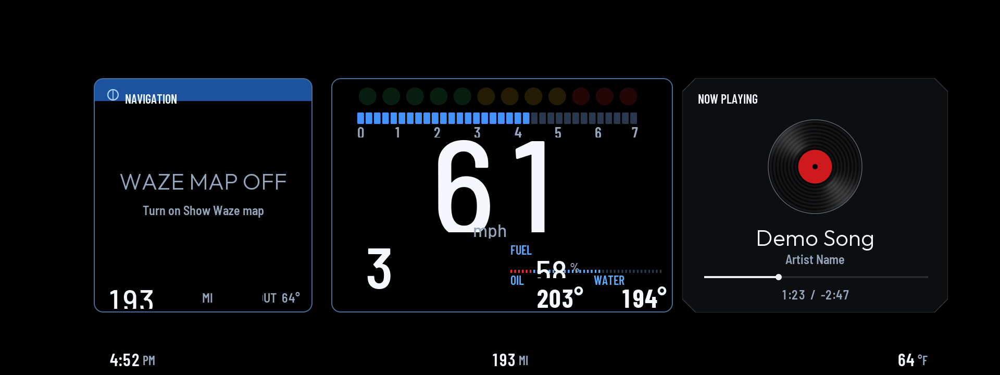
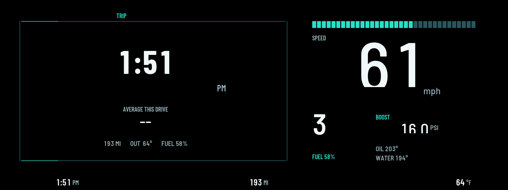
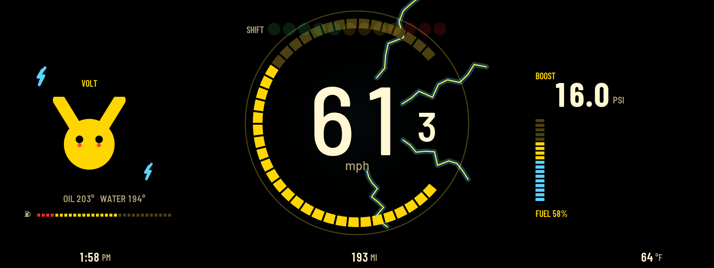
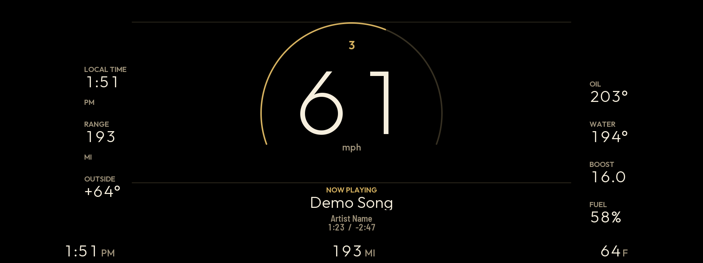
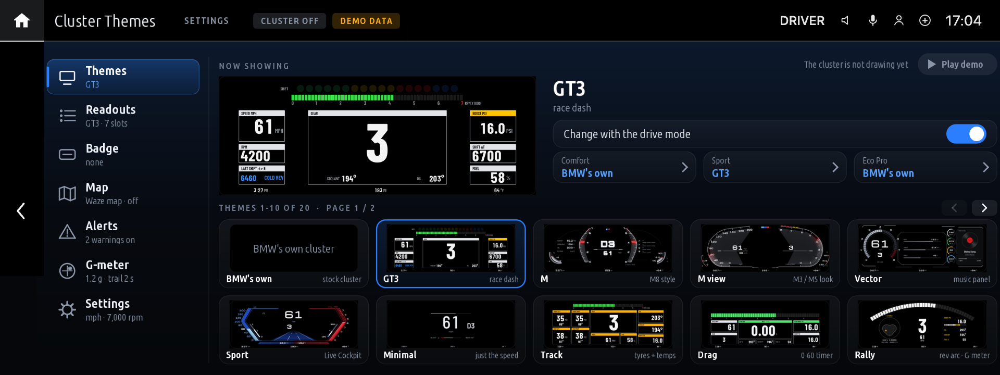

# Roiteam · Cluster Themes

<p align="center">
  
</p>

**Cluster Themes** turns the BMW iDrive 7 instrument cluster into a display you choose. Pick one of
19 themes on the centre screen, or let Comfort / Sport / Eco Pro pick one for you. It is drawn over
BMW's own cluster through [cluster-render](https://github.com/robertnisipeanu/idrive-apps), and it
only reads from the car.

**iDrive 7 only. cluster-render 0.5.1 or newer is required.**

> **Drive with BMW's warnings first.** The app's readouts are for information only. Follow BMW's own
> warnings and use *Off (BMW's own cluster)* whenever you want the original cluster back.

## Highlights

- **19 themes**, from a GT3 race dash and a current M8-style cluster to a calm highway layout, an
  80s digital dash, neon rings, gold minimalism and an iDrive 7-style three-card cockpit.
- **Navigation where you want it.** GT3, Sport, M, M view, Vector, Atlas and Cockpit open a window
  for the Waze map inside the theme.
- **Now playing.** Vector, Noir and Cockpit show the car's own media: title, artist, elapsed and
  remaining time; Vector and Cockpit also draw a record and progress line.
- **Live car data.** Speed, gear and drive mode, revs, boost, oil and coolant, intake air, fuel,
  range, outside temperature, tyre pressures and temperatures, G-forces, power and torque.
- **Shift lights and warnings** that follow your redline, shift point and cold-engine guard.
- **Theme pictures in the app**, so the centre screen shows what each theme looks like before you
  pick it.

## Themes

| Theme | What it is |
|---|---|
| **GT3** | A race dash with 18 shift lights, a segmented rev bar, speed, rpm, last shift, boost, fuel and a Waze map window. |
| **M** | A current M8-style cluster: two bowed rev blades, gear and speed, a tyre block, setup bars, fuel and oil dials, and a map version. |
| **M view** | BMW's newer M view: curved speed and rev scales, dark panels and an oval map window between them. |
| **Vector** | A race-sim dash: a segmented rev ring, ring gauges, boost/torque/power bars, a music panel and an octagonal map window. |
| **Sport** | BMW Live Cockpit Sport: a blue speed bracket, red rev bracket, a road in the middle, and the map when enabled. |
| **Minimal** | One huge speed, the gear beside it, a thin rev line and a thin fuel line. |
| **Track** | A race-dash frame with all four tyre pressures and temperatures, a big gear, speed, boost and configurable readouts. |
| **Drag** | A full-width shift bar, a 0-60 mph / 0-100 km/h timer, peak boost and the run's data. |
| **Rally** | A rev arc across the top, a huge gear, a G-meter, boost and configurable readouts. |
| **Retro 80s** | Amber seven-segment digits with faint unlit 8s, bar graphs and an 80s digital clock. |
| **Cruise** | A calm highway layout with a soft white speed, a row of figures and the average moving speed. |
| **Dyno** | BMW M-coloured telemetry tiles: twelve sensor tiles, two tall power/torque tiles and warning flashes. |
| **Ribbon** | A single ribbon of light that fills with the revs, a thin speed and optional holiday editions. |
| **Atlas** | The Waze map owns the left half; speed, gear and a compact readout stack sit on the right. With the map off, a trip panel takes its place. |
| **Volt** | Pikachu-yellow electric arcs that gather and reach further out as the speed climbs, with a rev ring and a little mascot. |
| **Twin** | Two round dials: a speed arc on the left, a segmented rev arc around the gear on the right, and a calm centre column. |
| **Pulse** | Neon cyan and magenta rings around a big speed, vertical rpm and boost columns, and a G-meter. |
| **Noir** | Warm gold on black: one huge thin speed under a rev arch, local time and range, and the now playing line. |
| **Cockpit** | An iDrive 7-style three-card view: navigation on the left, shift lights/speed/drive data in the middle, and now playing on the right. |

<p align="center">
  
  
  <br>
  
  
  
</p>

Every theme, with its screenshots and settings, is described in
[apps/perea_cluster_themes/README.md](apps/perea_cluster_themes/README.md).

<p align="center">
  
</p>

## What it can show

- **Navigation:** the Waze map inside the theme (GT3, Sport, M, M view, Vector, Atlas and
  Cockpit), plus range and outside temperature around it.
- **Media:** now playing from the head unit, with title, artist and track progress in Vector, Noir
  and Cockpit.
- **Engine and drive:** rpm, speed, gear and shifter programme, drive mode, boost, intake air,
  torque and power, oil and coolant, fuel and range.
- **Chassis:** tyre pressure and temperature per corner, lateral and longitudinal G, a G-meter
  with a trail and grip envelope, and a 0-60 mph / 0-100 km/h timer.
- **Driving aids:** shift lights and shift bar, last-shift grading, cold-engine rev guard, oil /
  coolant / boost warnings, night colours, holiday lights, and a demo drive for trying it parked.
- **Personalisation:** theme per drive mode, configurable readouts on the themes that support
  slots, badge and BMW lettering, units, clock and time zone, fuel tank size, redline and shift
  point, driver-camera space, and calibration layouts.

## Requirements

- BMW MGU head unit on **iDrive 7**.
- [cluster-render](https://github.com/robertnisipeanu/idrive-apps) **0.5.1 or newer**, installed
  from the `robertnisipeanu/idrive-apps` Store source. The Store cannot install it by itself.
- [MGU Store](https://github.com/robertnisipeanu/mgu-store) to install and update the app.

The app does not need the Store's own Renderer; it draws the cluster through cluster-render and
uses the head unit's normal centre-screen renderer for its page.

## Install

### From the Store

1. In the MGU Store, add the source `robertnisipeanu/idrive-apps` and install **Cluster renderer**
   (0.5.1 or newer).
2. Add the source `alexpereap/pereaperformance-idrive7-apps`, following the **main** branch.
3. Install **Cluster Themes**. The head unit builds the package itself.

### From a USB stick

Clone the Store, write the repository to the stick, and install from the Store's **USB** page:

```sh
git clone https://github.com/robertnisipeanu/mgu-store.git
node mgu-store/deploy/mgu-install.js usb-repo /media/<your-stick> /path/to/pereaperformance-idrive7-apps
```

Run the command again after an update; the Store offers the app again when its `version` in
`app.json` goes up.

### Build a package yourself

With an `oap-sdk/` extracted from your own unit (see `docs/cluster-themes.md`), run:

```sh
python3 kit/tools/build.py perea_cluster_themes
```

This writes `dist/perea_cluster_themes@<version>.tgz` and `.mgu`. Put the `.tgz` on the stick and
install it with `usb-repo`. Keep the files to yourself: they contain BMW's SDK.

## Use

Open **Cluster Themes** from the apps menu on the centre screen.

- **Themes:** the gallery shows ten themes a page, with arrows for the rest. Tap a theme to show
  it. The selected theme is highlighted.
- **Off (BMW's own cluster):** pick it to stop drawing and get BMW's cluster back.
- **Drive modes:** with *Change with the drive mode* on, Comfort, Sport and Eco Pro each use the
  theme picked for them. Turn it off to keep one theme everywhere.
- **Map:** enable *Show Waze map inside the theme* to let Waze draw into the theme's window. Waze
  on Cluster is required; the setting is on the Map tab.
- **Readouts:** GT3, M, Track, Drag, Rally, Retro 80s and Dyno have configurable readout slots.
- **Settings:** units, clock and time zone, fuel tank size, redline, shift point, cold guard,
  warnings, night colours, holiday editions, driver-camera space and demo data.

The app is read-only: it does not send anything to the car. Its log and diagnostic file live in
`/var/opt/public/oap/oap_<uid>/data/` on the unit.

## Safety

Cluster Themes draws over BMW's own instrument cluster. The information is provided for
convenience and is not a replacement for BMW's warnings, telltales or service information. Use
*Off* whenever you need the original cluster, and drive with your own judgement. Use at your own
risk.

## Development

The repository contains the complete cluster engine, the theme layouts and the preview tooling.
Node 18+ and Python 3 are needed on the computer; the app itself runs on the unit's Node 8.

```sh
python3 kit/tools/build.py --preview-only perea_cluster_themes   # stage without an SDK
python3 kit/tools/build.py perea_cluster_themes                  # build a package (needs oap-sdk/)
node kit/tools/emu.js perea_cluster_themes                       # live emulator: http://localhost:8077
node kit/tools/test_cluster_themes.js                            # stage, start, draw the default theme
node bench/server.js                                             # cluster bench: http://localhost:8078
```

- Theme layouts: `apps/perea_cluster_themes/hud/layouts/*.json`
- Colours: `shared/hud_themes.js`
- Engine: `shared/hud.js` (the widget reference is at the top of the file)
- Preview pictures: `tools/previews.py`
- Full development notes: [docs/cluster-themes.md](docs/cluster-themes.md)
- Bench and signal controls: [bench/README.md](bench/README.md)

The project is currently **0.21.0**.

## Credits and licences

Cluster Themes is based on [bimmer-lab](https://github.com/bimmer-lab/apps)'s app (0.19.0, MIT).
The themes, the centre-screen page, the drawing engine, the bench and the tools are their work;
this repository keeps that credit and adds the install fix, the unit-fitting build step, six new
themes and the renderer/preview fixes. The complete app manual is in
[apps/perea_cluster_themes/README.md](apps/perea_cluster_themes/README.md).

- **Cluster renderer** and its client: [robertnisipeanu/idrive-apps](https://github.com/robertnisipeanu/idrive-apps),
  MPL-2.0 for `shared/cluster_render_client.js`.
- **MGU App Kit** and emulator: [cauliflowermossgrape/idrive7-apps](https://github.com/cauliflowermossgrape/idrive7-apps),
  MIT; fonts under the Ubuntu Font Licence and SIL OFL; the emulator's draw engine is GPL-3.0-or-later.
- **Cluster Themes app:** bimmer-lab, MIT, Copyright (c) 2026 bimmer-lab.
- **BMW's SDK** and packages containing it are never published in this repository.

The full notices are in [THIRD_PARTY_NOTICES.md](THIRD_PARTY_NOTICES.md) and
[apps/perea_cluster_themes/NOTICE](apps/perea_cluster_themes/NOTICE).
