# Cluster Themes

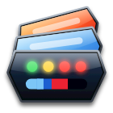

> **Cluster Themes is [bimmer-lab](https://github.com/bimmer-lab/apps)'s app, and all credit for it goes to bimmer-lab**: the themes, the centre-screen page, the drawing engine (`shared/`), the bench and the tools are their work, with the projects they build on listed in [NOTICE](NOTICE). Everything from [Themes](#themes) on is bimmer-lab's own text, except the Atlas, Volt, Twin, Pulse, Noir, Cockpit, Aurum, Apex and Eclipse sections and Vector's directions paragraph; the issue numbers in it are their repository's.
>
> iDrive 7 only. Install **cluster-render** 0.5.1 or newer first (Store source `robertnisipeanu/idrive-apps`).

Working on it: [docs/cluster-themes.md](../../docs/cluster-themes.md).

Redraws the whole instrument cluster in a theme of your choice. Open **Cluster Themes** from the apps menu on the center screen: its own page has the themes with pictures, the readouts, the badge, the Waze map, warnings and settings.

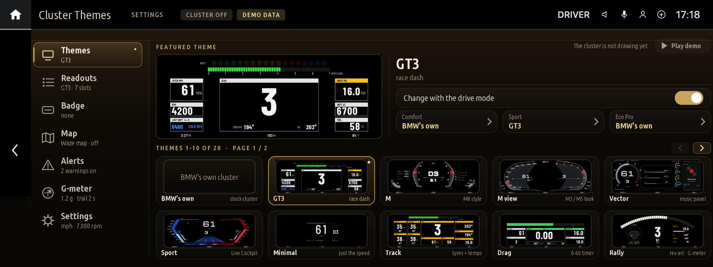

## Themes

Every theme fills the cluster and shows its own clock, range and outside temperature along the bottom, in the theme's style. Only BMW's gear letter at the bottom right stays uncovered: when a theme covers it, BMW draws a black box over the theme (issue #5). Every theme shows the drive mode (Comfort, Sport and so on); most show it next to the gear, while M view keeps it above the now playing card.

### GT3

A race dash.

- **Top:** 18 round shift lights (green, yellow, red, then blue) and a segmented rev bar. The lights come on from 3000 rpm and fill up to your shift point.
- **Left:** speed, rpm, and your last shift with its grade.
- **Middle:** the gear, with water and oil temperatures.
- **Right:** boost, your shift point, and fuel.
- **At the shift point** the lights, the rev bar, the rpm and the gear all go red.

### M

A current M8's cluster, traced off a photo of it and drawn on black.

- **Middle:** two bowed glass rev blades either side of the gear and speed, reading 0 to 7000 rpm like the M40i's own cluster. A red marker rides each blade at the rpm, the blade glows below it, and orange and red marks sit before and past your redline. The gear shows with its shifter programme: P, D3, S3 or M3, and the drive mode sits under the speed.
- **Left:** a black card with a grey rim and four readouts where the M8 has its tyre block: boost, coolant, oil and intake air out of the box, each one changeable on the Readouts tab. The fuel dial sits over the card's lower corner, drawn like the M8's: a thin glass bracket inside a hatched chrome bezel, lit from the bottom up to the level, with a thin red line at the level.
- **Right:** what the engine, chassis, steering and gearbox are set to, as four rows with a step bar, and the oil temperature dial, the same glass bracket. The rows follow the drive mode buttons: Eco Pro, Comfort, Sport, Sport Plus and Sport Individual. The car only reports that an Individual setup is on, not what each part is set to, so those rows read INDIVIDUAL.
- **Bottom:** the clock, range and outside temperature, with BMW's own gear letter.
- **With the Waze map:** the blades keep their shape and numbers and move out to the sides, the map fills the middle between them, and the gear, speed and drive mode sit in a row under it.

### Sport

The look of BMW's newer Live Cockpit Sport view.

- **Left:** speed as a blue bracket on BMW's 0 to 200 mph scale (0 to 320 km/h), with a fuel bar up its lower leg. Inside it is a small **navigation** window: the Waze map when enabled, or *WAZE MAP OFF* while it is closed.
- **Right:** revs as a red bracket on the M40i's 0 to 7000 rpm scale, with yellow and red marks around your redline, with an oil temperature bar up its lower leg. Inside it is a small **now playing** card: record, title, artist, progress and elapsed/remaining time, or *NO MEDIA* with the drive average.
- **Middle:** the speed in big figures with the gear and drive mode under it, over a road like BMW's own Sport view whose lane dashes run towards you as you drive. The dials and their numbers stay exactly where they were; the navigation window is in the left bracket and the media card in the right one.
- **Bottom:** boost and coolant in the blue and red bar. Under it, the clock, range and outside temperature, with BMW's own gear letter.

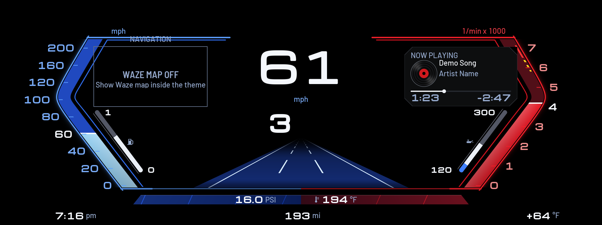

### M view

The look of the M view in the newer M cars' Live Cockpit (M3, M4, M5), for any car. Asked for in issue #15.

- **Left:** speed along a white line with rounded corners, 0 to 200 mph (0 to 330 km/h). The band inside the line lights up from 0 to the needle.
- **Middle:** navigation. With "Show Waze map inside the theme" on, the map shows in an oval window between the two scales that fades into the black, and the window opens and closes without the theme being built again. With the map off, it says *WAZE MAP OFF*.
- **Right:** revs along the mirrored white line, 0 to 8000 rpm, with yellow and red marks from your redline. Inside that panel is the **now playing** card: a record, the song, artist, progress, elapsed and remaining time. With nothing playing it shows *NO MEDIA* and the drive's average speed.
- **Mode:** the drive mode above the media card. M view leaves the gear number out.
- **Panels:** dark grey panels inside both scales, and a red glow by the needle, as on BMW's own M view.
- **Corners:** fuel on the far left and oil temperature on the far right, as small dials.
- **Bottom:** the clock, range and outside temperature, with BMW's own gear letter.

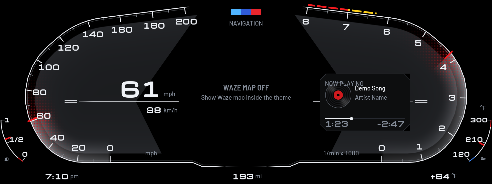

### Vector

A race-sim style dash with angled frames and a music panel.

- **Left:** a round rev counter in segments, 0 to 8000 rpm, red from your redline, with the speed and the gear inside it.
- **Middle:** the next turn, its distance, street and lanes while a route runs in BMW's navigation, CarPlay (Apple Maps) or Android Auto; the boost, torque and power bars step aside and come back when the route ends. With "Show Waze map inside the theme" on, the Waze map shows in the octagon instead (directions can sit over it). "Directions in the cluster" chooses while a route runs, near turns, or off.
- **Right:** coolant, oil, fuel and boost as rings, and the music panel: the song that is playing with its title, artist and time, read from the car's own now playing. When nothing is playing, the panel shows average speed, peak boost and lateral G instead. The music panel is experimental: please tell us in an issue whether it works with your sources (radio, Bluetooth, USB, CarPlay).
- **Bottom:** the clock, range and outside temperature, with BMW's own gear letter.

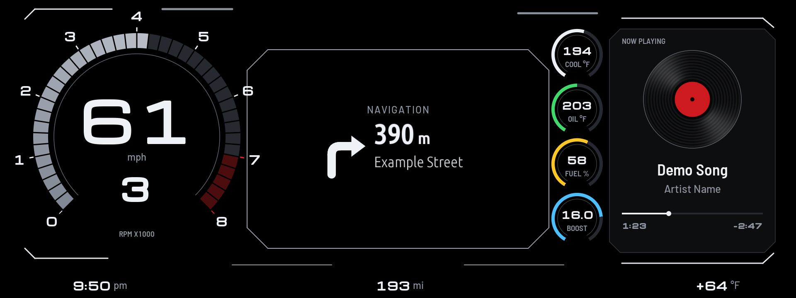

### Minimal

Just the speed, big, with the gear and drive mode beside it, a thin fuel line under it (the reserve end is red), and oil and coolant in small print.

### Track

A race dash for track days: a shift bar across the top, a big gear with the speed under it, all four tyres (pressure and temperature, from the car's tyre monitor) on the left, oil, coolant and boost on the right (changeable), and fuel.

### Drag

A full-width shift bar and a 0 to 60 mph timer (0 to 100 km/h in metric). Stop for half a second and it reads READY; the clock starts the moment the car moves and stops at 60. Your best time is kept. Also the speed, the gear, the peak boost of the run, oil, coolant, fuel, and one readout you pick. The timer runs off the car's speed signal, which reads a little under BMW's speedometer, so treat it as a good guide rather than a timing gear.

### Rally

A segmented rev arc sweeps across the top of the screen, white, then rally yellow from the shift zone, red and flashing at the redline. A huge gear sits in the middle with the speed under it. On the left a G-meter: a dot shows the cornering and braking or accelerating force (it moves into the turn and up when you speed up), white, then amber from 0.5 g, then red from 0.8 g, with a fading trail behind it and an outline of the most g you reached this drive in every direction. Under it the g now (left or right, accelerating or braking), and the best of the drive. Boost with a peak-hold bar and three readouts on the right (oil, coolant and fuel out of the box).

### Retro 80s

An 80s digital dash: amber seven-segment digits with their unlit 8s showing faintly behind, for the gear and the speed. A segmented rev bar runs across the top, bar graphs show oil, water and fuel on the left, and boost and two readouts sit on the right. The clock, range and outside temperature along the bottom are seven-segment digits too.

### Cruise

Calm and quiet for the highway: the speed in soft white, the gear beside it, and one row of figures (fuel, oil, coolant, rpm and your average speed this drive). No rev bar, and nothing red until the fuel runs low. The average speed counts only time moving and shows after the first minute of the drive.

### Dyno

A safety dash for hard pulls, in BMW M colours: twelve tiles in a grid (rpm, speed, boost, oil, coolant, intake air, cornering g, braking or accelerating g, the gear, fuel, your shift point and your last shift) and tall Power and Torque tiles on the right, each with a bar that runs light blue, dark blue, then red. A tile's number flashes red while its oil, coolant or boost reading is over your warning limit. A rev bar runs across the top. Every tile but the gear can show another sensor (Readouts tab).

### Ribbon

Calm and premium. One ribbon of light runs along under the top edge of the cluster and fills with the revs, cool white warming to amber, then red near the redline, with a dot and a number at every thousand (the last two in red). The speed sits in the middle in big thin numbers with the gear in a small frame above it. Oil, coolant and boost are on the left, and fuel and your average speed this drive on the right.

**Holiday editions:** Christmas (the ribbon becomes a string of coloured bulbs that light up with the revs, with falling snow), Thanksgiving (falling maple leaves), New Year (bubbles and gold confetti) and the Fourth of July (fireworks), each with its own colours and a greeting under the speed. The decorations stay clear of the numbers. Set by **Holiday editions** in Settings.

### Atlas

A navigation-first theme: the Waze map owns the left half behind a thin teal frame, and the speed, gear, shift bar and a compact readout stack sit on the right. With the map off, the left side turns into a calm trip panel with the clock, average speed, range, outside temperature and fuel.

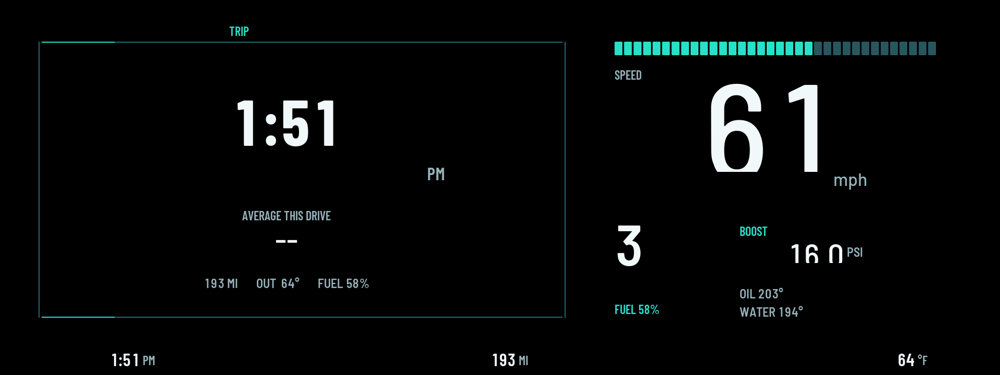

### Volt

Pikachu yellow and electric blue on black. A segmented rev ring and the speed sit inside a field of lightning: more bolts switch on and reach further out as the speed climbs, and they flash white at the shift point. The little electric mascot keeps watch on the left, with the shift lights, boost and fuel around it.

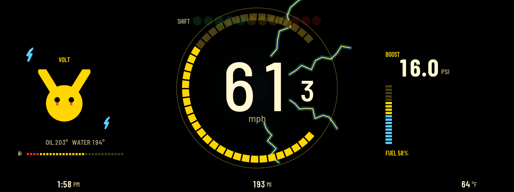

### Twin

Two round dials and one calm centre column: a speed arc with its peak dot on the left, a segmented rev arc around the gear on the right, and fuel, oil, water and boost between them. White numbers with BMW red needles.

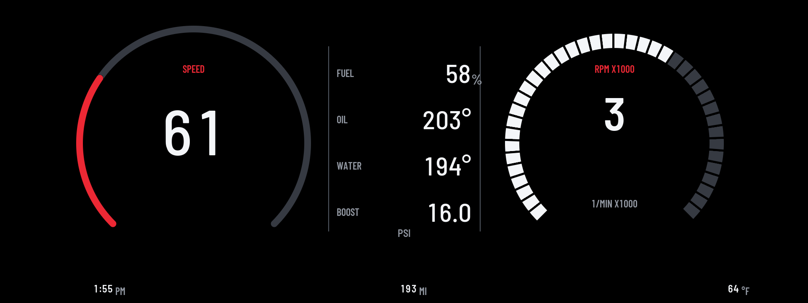

### Pulse

A full-screen city map. With "Show Waze map inside the theme" on, the live Waze map fills the whole background; with it off, a light paper map (dark after sunset) keeps the layout, so the theme reads as a map at a glance.

- **Top bar:** the next turn (BMW navigation, CarPlay with Apple Maps, or Android Auto) or a NAVIGATION / WAZE MAP label, the shift lights, and now playing (or this drive's average).
- **Bottom bar:** the drive mode, fuel and range, the huge speed and gear, the clock and outside temperature, and the Ankara weather line.
- **Map:** the Waze map fills the entire background and the bars sit over it; the BMW gear letter keeps its window in the bottom bar.

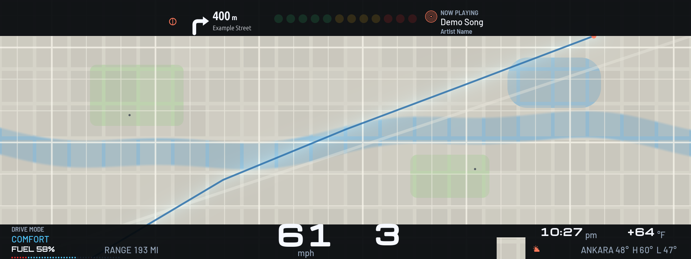

### Noir

Warm gold on black. One huge thin speed under a wide rev arch, the gear in a small gold frame, local time and range on the left, engine readings on the right, and the now playing line (or this drive's average) under a thin rule.

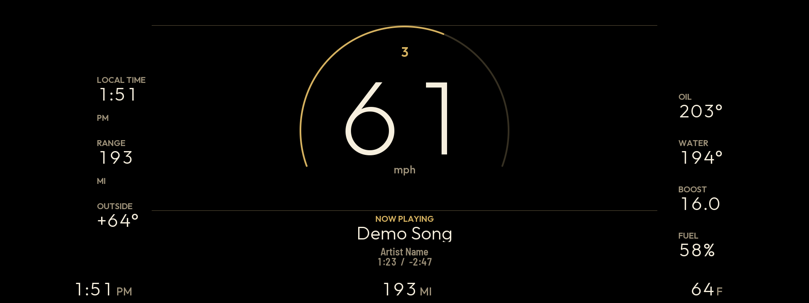

### Cockpit

A calmer, iDrive 7-style Live Cockpit: three cool-blue cards under one black screen. The left card is **navigation**, with a compass, the Waze map opened inside it, range and outside temperature. The middle card carries the shift lights, rev bar, speed, gear and the drive readouts. The right card is **now playing**, with a spinning record, the song's title and artist, and the track's progress.

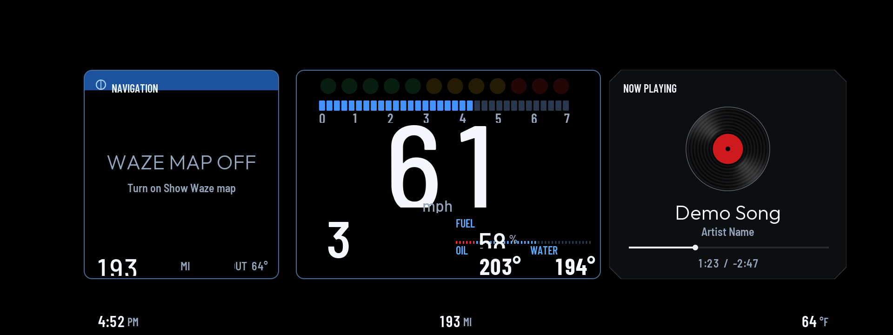

### Aurum

A showpiece in warm black and champagne. The background is a radial art-deco sunburst with champagne rings, a large diamond frame, and lit speed/rev arcs; the numbers float over it instead of sitting in cards. Shift lights run across the top.

- **Left:** navigation (the Waze map in its cut-out window) and all four tyre pressures and temperatures, with fuel, range and a thin fuel bar.
- **Right:** now playing with a record, title, artist, progress and time; the 0-60 timer with its best; boost, intake, average speed and the Ankara weather line.
- **Centre:** the huge speed, gear, drive mode, G-meter, shift point and last shift.
- **Theme:** the sunburst, diamond and rings are drawn by the theme's own shader; holiday decorations and the DEMO tag when the demo is running. No oil, coolant, torque or power readouts.

### Apex

Aurum's sport sibling, in midnight blue. The same floating layout, but the backdrop is a deep navy with a hexagonal frame
and cyan/ice accents: a radial sunburst, lit speed and rev arcs, navigation and tyres on the left, now playing and the
0-60 timer on the right, and the G-meter beside the gear. The Ankara weather line sits under boost and intake. No card
grid; no oil, coolant, torque or power readouts.

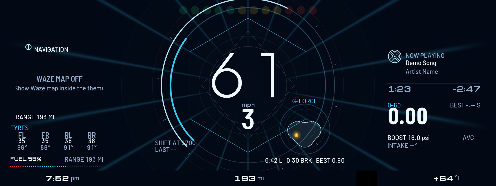

### Eclipse

A deep indigo night in three horizontal bands, not another side-column layout. The header carries navigation, the ECLIPSE wordmark with the drive mode, and now playing; the hero is one dark eclipse disc with an amber/ice corona, a tight lit speed/rev ring, the huge speed and gear, with all four tyres floating left and the G-meter right; the console across the bottom carries fuel and range, the shift data, the 0-60 timer, boost and intake, average speed, the best G and the Ankara weather line. No card grid, no oil, coolant, torque or power readouts; the holiday decorations and DEMO tag stay.

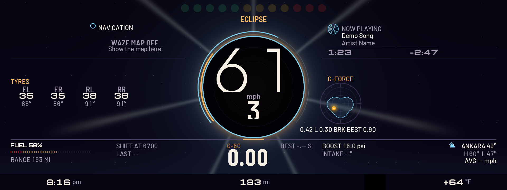

### Weather

Aurum, Apex, Eclipse and Pulse show Ankara's current weather in their lower right corner: the temperature, the day's high and low, and a small condition icon. It comes from [Open-Meteo](https://open-meteo.com) (no account and no key; only Ankara's coordinates are sent), refreshes every 15 minutes and keeps the last answer in the app's data folder. **Ankara weather (online)** in Settings turns it off. Without internet the line stays hidden; an answer older than 6 hours is not shown. Weather data by [Open-Meteo.com](https://open-meteo.com), CC BY 4.0.

Minimal, Track, Drag, Rally, Retro 80s, Cruise, Dyno, Volt, Twin, Pulse and Noir have no map window yet; with "Show Waze map inside the theme" on, Waze stays in its usual place while they show. GT3, Sport, M, M view, Vector, Atlas, Cockpit, Aurum, Apex and Eclipse open a window for it.

More themes are on the way.

## Off and drive modes

- **Off (BMW's own cluster):** pick it as the theme and the app draws nothing, so BMW's cluster comes back.
- **Change with SPORT / COMFORT / ECO PRO** (on by default): the cluster follows the drive mode buttons, with a theme for each mode. Out of the box, Sport shows GT3, and Comfort and Eco Pro show BMW's own cluster. Until the car reports a mode, the plain theme setting is used.
- **M cars:** the Efficient, Sport and Sport+ modes of M cars are not recognised yet, so the theme doesn't change with them. The last line of the Settings tab shows the value your car sends; please post it in an issue so it can be added.
- **With HUD Widgets:** on cluster-render 0.5.1 and newer, a cluster theme and a HUD layout show at the same time. On older cluster-render they share one screen slot and take turns: pick a theme while the HUD is on and the page asks whether to turn HUD Widgets off, and it asks the same the other way round.

## Settings

- **Theme**, and one per drive mode.
- **Readouts:** pick which car sensor each GT3, M, Track, Drag, Rally, Retro 80s or Dyno readout shows (speed, rpm, boost, temperatures, tyres, fuel, g, power and more). Plug-in hybrids can also show **Hybrid battery**, the high-voltage battery's charge in % (not yet checked on a hybrid).
- **Show Waze map inside the theme:** GT3, M, M view and Vector open a window in the middle; Sport opens a small one in its left bracket, and Atlas, Cockpit, Aurum, Apex and Eclipse open one on the left. Waze on Cluster draws its map there above BMW's own map view, so nothing shows twice. When the map goes away the theme fills back in. While it is on, Waze's map on the HUD is off. Needs robertnisipeanu's Waze on Cluster; turning it off gives Waze its usual place back.
- **Directions in the cluster:** Vector's middle shows the next turn, distance, street and lanes from BMW's navigation, CarPlay (Apple Maps) or Android Auto. While a route runs, near turns, or off. Waze sends no turns to the car, so with Waze only the map window shows.
- **Ankara weather (online):** Aurum, Apex, Eclipse and Pulse show Open-Meteo's current Ankara weather (temperature, high/low and a condition icon). On by default; turn it off to stop the requests. Needs the head unit's internet.
- **Badge:** the model name, like "BMW X3 M40i", as text in the theme's font (GT3 top left, Sport, M and Minimal top centre, where BMW puts its own). Off by default.
- **Warnings:** oil, coolant and boost limits. A readout over its limit flashes red (oil 130°C and coolant 115°C by default, boost off).
- **Test the shift lights:** runs the rpm up to the shift point for about 4 seconds while the car stands.
- **Play demo:** the button at the top of the page plays a 60-second show on the cluster while the car stands (a pull through the gears with graded shifts, the limiter, braking, corners, boost, the oil warning once), with a DEMO tag. It stops at the end, on Stop, or as soon as the car moves, and nothing from it is kept.
- **Shift lights:** Count in (the default) fills the lights over about the last second before the shift point and flashes early by your reaction time; Fixed rpm band works as before. Ported from Redline (MIT).
- **Temperatures only when they matter** (off by default): oil and coolant turn blue while cold, yellow while warming, red over their limit; the outside temperature turns blue at 3°C (37°F) and under.
- **Night colours:** after sunset the theme's whites and greys dim to 60% (Auto, the default), or Off.
- **Units:** mph, °F, psi or km/h, °C, bar.
- **Clock:** 12-hour or 24-hour.
- **Time zone (clock):** the head unit's clock runs on UTC, so pick your zone once. Named zones (US Eastern, Central, Mountain, Pacific, Alaska, Hawaii, Arizona, Canada Atlantic, Mexico, UK / Ireland / Portugal, Central Europe, Eastern Europe) change for daylight saving by themselves; for anywhere else, pick your offset from UTC. Night colours uses the same zone to work out sunset.
- **Fuel tank size:** the fuel gauge asks the engine unit for the level in %. Where the engine unit doesn't answer, it works it out from the litres the car reports and this size (65 L on an X3, 59 L on a 3 Series).
- **Redline:** where the red marks start on the rev scales (they always cover at least the last 500 rpm, and the yellow marks sit in the 700 rpm before them).
- **Shift point before redline:** how far below the redline the shift lights peak (300 rpm by default).
- **Cold-engine rev guard:** until the oil reaches 80°C, the shift point starts at 4500 rpm and climbs as the oil warms up.
- **Show boost.**
- **Leave room for the driver camera** (off by default): for newer cars with a driver attention camera in the top middle of the cluster, where other cars show the model badge. The shift lights and rev bars (GT3, Track, Dyno, Rally) become two mirrored wings either side of the camera that fill from the outer ends in towards it and meet at the shift point, Track's rpm numbers are left out, M's logo is hidden, and Ribbon's ribbon dips under the camera instead. The camera's spot is taken from where the badge sits on a car without one. Not yet tested on a car with a camera; please report how it lines up on yours.
- **Holiday editions:** a string of glowing holiday lights along the top of every theme, and Ribbon's own holiday edition. Auto (the default) puts them on by the date: Thanksgiving in its week (Monday to Sunday), Christmas from December 1 to 26, New Year from December 27 to January 2, and the Fourth of July from July 1 to 5, then takes them off again. Or pick one holiday to keep it on, or Off. The date follows the Time zone (clock) setting.
- **G-meter** (its own tab): the range (0.8, 1.0, 1.2, 1.5 or 2.0 g at the edge; 1.2 by default), the trail (off, 1, 2 or 4 seconds), **Swap left / right** (if the dot goes the wrong way in a turn) and **Brake on top**, the best left, right, accelerating, braking and overall g of the drive with a Reset button, and a live copy of the meter. The g comes from the car's own acceleration sensor: parked on level ground it reads 0.00, and a hill adds a little.
- **Demo data:** fake driving data for trying it out parked. It switches back to the car's own data as soon as the car moves faster than 5 km/h.
- **Calibration grid:** a theme that draws lines every 50 px with labels, for checking on a photo where things land on the real screen. It also carries a few test marks used to measure cluster-render's limits on the car.
- **Map calibration:** a theme that leaves BMW's whole map window open with a grid through it, for photographing exactly what shows through the map cut-out with a navigation map up.

**Shift grades:** every upshift is graded on its peak rpm. EARLY means more than 250 rpm under the shift point, LATE more than 200 over it, COLD REV the same while the cold guard is on, LIMITER within 25 rpm of the redline, and anything in between is SPOT ON. Only shifts aimed at the shift point are graded: one more than 1500 rpm under it (an everyday shift) or one the gearbox made itself in D or S is left out, and the last grade stays on screen. When Redline 2.0.28 or newer is running, the shift point and the grade come from Redline, which learns a shift point for each gear.

## Requirements

[cluster-render](https://github.com/robertnisipeanu/idrive-apps), installed from the `robertnisipeanu/idrive-apps` Store source. Version 0.5.1 or newer lets the theme show together with HUD Widgets.

## On the car

bimmer-lab tested it on a 2020 X3 M40i. Checked on that car: GT3 and Dyno draw complete, the Waze map shows inside GT3 and Sport, and a theme and a HUD layout show together. Still to be checked:

- the other themes on the real screen, including M since its 0.10.0 rework;
- whether BMW's warning lights still show over the dash (start the car with a seat belt off and look);
- the clock with a named time zone, and the fuel % from the engine unit;
- the Hybrid battery readout on a plug-in hybrid;
- Play demo, the count-in shift lights and the switch-off guard (0.16.0).

If something looks wrong on your car, the last line of the Settings tab says what the app is doing and why anything is not drawn. Please open an issue with it (for the app itself, in [bimmer-lab/apps](https://github.com/bimmer-lab/apps/issues)).

See bimmer-lab's [Use at your own risk](https://github.com/bimmer-lab/apps#use-at-your-own-risk) before installing.

Version history up to 0.19.0 is in bimmer-lab's [CHANGELOG.md](https://github.com/bimmer-lab/apps/blob/main/CHANGELOG.md).
